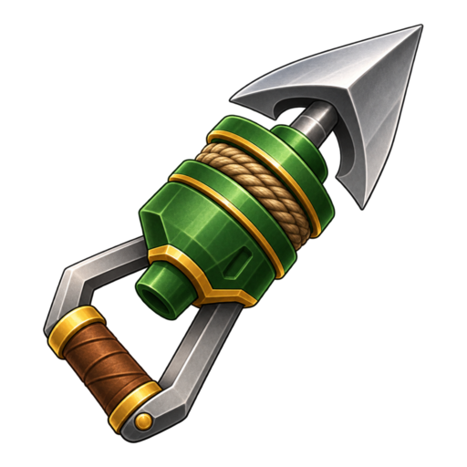

<h1 align="center">
   
  

   
  <b>Longshot</b>
   
</h1>

<h4 align="center">A supported console game running natively on Windows & Linux, without emulation.
</h4>

  <a href="https://longshot.magicbean.dev/"><b>Website</b></a> |
  <a href="https://longshot.magicbean.dev/download"><b>Download</b></a> |
  <a href="https://discord.gg/magicbean"><b>Discord</b></a> |
  <a href="#project-status">Status</a> |
  <a href="#install-and-play">Install and play</a> |
  <a href="#build-from-source">Build from source</a> |
  <a href="#how-it-works">How it works</a> |
  <a href="#want-to-help">Want to help?</a> |
  <a href="#license">License + Credits</a>

This website is our Git hosting, similar to GitHub.

Longshot is a static recompilation of a supported console game. The game's code is translated to C and compiled into a Windows or Linux program, rebuilding the graphics on Vulkan, with the console's system software reimplemented. All of this happens **on your PC, from your own copy of the game**.

Longshot is a continuation of [Hookshot](https://github.com/NotRexed/Hookshot). The top maintainers have moved to this project.

**[Join us on Discord](https://discord.gg/magicbean)!**
 

> [!IMPORTANT]
> This repository **does not contain the game, keys or an executable**, and it does not explain how to get them. You
> need your own copy. Everything the build creates (`longshot.exe`, the generated code, the shader caches and your
> saves) comes from your game and stays on your PC. Never share those files.

## Project status

Experimental. Players have reported on many PCs, from Kokiri Forest to the dungeons: the table says what works and
what does not yet. Open problems are collected in tracking issues, linked below.

| What | Status |
|---|---|
| Kokiri Forest: reaching gameplay and walking around | ✅ Works |
| Sound, controller, keyboard and saves | ✅ Works |
| In-game menu, frame generation and upscaling | ✅ Works |
| Flicker (the picture flashing too bright while moving) | ✅ Fixed in v2.0.2 ([#645](https://github.com/NotRexed/Hookshot/pull/645)) |
| Ground fog vanishing when looking down | ✅ Fixed in v2.0.2 ([#638](https://github.com/NotRexed/Hookshot/pull/638)) |
| Models with missing pieces (doors, fences, parts of trees) | ✅ Fixed where tested, more play needed |
| Stutter when entering new areas | ⚠️ Still happens the first time you visit a place. The next visits are smooth |
| Performance | ⚠️ Depends on the PC: some reach a steady 60 fps, others stay below it, more so in Hyrule Field |
| Hyrule Field, Castle Town, Kakariko and the dungeons | ⚠️ Players got there, with open bugs: lighting and shadows ([#1004](https://github.com/NotRexed/Hookshot/issues/1004)), crashes and freezes ([#2507](https://github.com/NotRexed/Hookshot/issues/2507)) |
| Ultrawide and 4:3 | ✅ Works. The Aspect ratio row's default, Monitor's shape, widens the 3D to the screen and keeps the HUD and movies in the middle 16:9 ([#2119](https://github.com/NotRexed/Hookshot/pull/2119)) |
| NVIDIA cards | ✅ Works. The most tested |
| AMD cards | ⚠️ Many tested: reports from the RX 6600, RX 6800 XT, RX 7800 XT, RX 7900 XTX and RX 9070 XT. On Windows, the RX 6600 to RX 6950 XT and their mobile and Pro models (Navi 21, 22 and 23) draw task and mesh shaders through the compute fallback by default: the driver lost the GPU on their own mesh shaders on an RX 6700 XT, an RX 6800 XT and, in one report in Mako, an RX 6600 ([#1747](https://github.com/NotRexed/Hookshot/pull/1747), [#1992](https://github.com/NotRexed/Hookshot/pull/1992), [#2215](https://github.com/NotRexed/Hookshot/pull/2215)); another RX 6600 played 15-20 minutes on them ([Longshot #130](https://git.magicbean.dev/MagicBeanDev/Longshot/issues/130)). The RX 6400 and 6500 XT (Navi 24) keep their own mesh shaders, as no report has them losing the GPU; `RX_VK_TASK_MESH_FALLBACK=1` tries the fallback. Driver crashes and device lost are still reported ([#996](https://github.com/NotRexed/Hookshot/issues/996)) |
| Intel cards | ❓ Few reports, many of them black screens or crashes ([#999](https://github.com/NotRexed/Hookshot/issues/999)). On Windows, Intel's shader compiler is entered by one thread, and a shader it faults on is left out instead of closing the game, on later starts too ([#252](https://git.magicbean.dev/MagicBeanDev/Longshot/pulls/252)). Made for an Intel UHD laptop with 4 threads and 16 GB that crashed in `igvk64.dll` (see [Intel laptops](docs/troubleshooting.md#intel-laptops)): not yet tested on an Intel GPU |
| Pre-rendered movies on a slow CPU | ⚠️ Shown rather than skipped when the decoder is slower than the movie, so the picture can fall behind the sound. With 4 logical processors or fewer the decoder uses 2 threads, leaving the game its own. The first picture can still be black on some PCs |
| Cards without mesh shaders (such as NVIDIA GTX 10 and AMD RX 5000) | ⚠️ Run through the compute fallback (since v2.0.6), which runs the mesh programs as compute shaders on cards with buffer device addresses: slower, and it leaves out the mesh draws that take their count from a buffer ([#640](https://github.com/NotRexed/Hookshot/issues/640)) |
| Linux | ✅ Works with the AppImage. Tested on several distributions (CachyOS, Fedora, Bazzite, SteamOS) and cards, with open problems on some AMD cards ([#1000](https://github.com/NotRexed/Hookshot/issues/1000)) |

## Install and play

### [🪟 &nbsp;Download for Windows](https://longshot.magicbean.dev/download/launcher/windows)

### [🐧 &nbsp;Download for Linux (AppImage)](https://longshot.magicbean.dev/download/launcher/linux)

Windows without installing: [portable zip](https://longshot.magicbean.dev/download/launcher/windows-portable) · Not sure?
[longshot.magicbean.dev/download](https://longshot.magicbean.dev/download) picks for your computer. These links give the
newest launcher (stable, or until there is one, the release candidate); for each channel's own, see
[release channels](docs/install.md#release-channels).

**Download the launcher, not the builder.** The files on [Longshot's releases](https://git.magicbean.dev/MagicBeanDev/Longshot/releases)
(`LongshotBuilder-…-windows-x64.zip`, `Longshot-…-x86_64.AppImage`, `tools.lock`) are what the launcher installs for
you. Windows may flag the launcher as a Trojan: it isn't, it's just not code-signed yet. See
[antivirus warnings](https://longshot.magicbean.dev/help/antivirus/).

Longshot doesn't come ready to play: it is built on your PC, from your own copy of the game. The
**[Longshot Launcher](https://longshot.magicbean.dev/download)** does all of it for you:

1. Check that your PC and your copy of the game match [what you need](#what-you-need).
2. Download the launcher for [Windows](docs/install.md#on-windows) or [Linux](docs/install.md#on-linux) and start it.
3. Point it at your game and press **Build**. It downloads this version's Longshot Builder, checks it against the
   release's signed checksums, and builds the game: about 15 minutes on a 12-core desktop, longer on a slower PC
   ([build times](docs/development.md#build-times)).
4. Press **Play**. From then on the launcher keeps the game, and itself, [up to date](docs/install.md#updating).

Longshot's first version will be **v3.0.0**; the launcher's first will be **v1.0.0** (its numbers are its own).

### What you need

<!-- website/src/content/docs/requirements.mdx copies this section: when one changes, change the other to match. -->

**Your game copy:** program `0400486024DEC000` · update **v131072** · build `e0f3ccfa`.
Use a `.nup` file, or the `romfs` and `exefs` folders. Other game versions are not supported.

These are estimates from the [tested configurations catalogue](https://longshot.magicbean.dev/tested-configurations/), not a promise of a particular
frame rate: the game runs on more than this, and performance depends on the resolution and settings you choose.

| Component | Minimum | Recommended |
|---|---|---|
| **Operating system** | **64-bit Windows 10 / 11**, or **64-bit Linux** with glibc 2.35 or newer. | Same. |
| **Processor** | A 6-core x86-64 CPU, such as an AMD Ryzen 5 2600 or Intel Core i5-8400. **AVX2 is required for the Linux AppImage**; Windows and source builds also run without it, more slowly. | AMD Ryzen 5 5600 or Intel Core i5-12400 or newer. For a steady 60 fps in demanding outdoor areas, a Ryzen 7 5700X3D or Core i5-13600K. |
| **Graphics card** | **Vulkan 1.3.** NVIDIA GeForce GTX 1060 6 GB or GTX 1650, AMD Radeon RX 5500 XT, or Intel Arc A380. | **Vulkan 1.3 with mesh shaders.** NVIDIA GeForce RTX 3060 or RTX 4060, AMD Radeon RX 6600 XT or RX 6700 XT, or Intel Arc A750. Check the [project status](#project-status) for each maker's known issues. |
| **Mesh shaders** | Not required: without them, Longshot draws through a slower compute fallback. | **Strongly recommended:** NVIDIA RTX 20 series and newer, AMD RX 6000 series and newer, Intel Arc. |
| **Video memory (VRAM)** | **4 GB**, with the in-game Minimum (4GB) or Low (6GB) quality preset. | **8 GB or more.** |
| **System memory (RAM)** | **16 GB.** See the memory guidance below. | **16 GB or more.** |
| **Storage** | **About 60 GB free while building.** A hard drive works, but builds are much slower. | **An SSD with about 60 GB free.** |

**Below the minimum:** a laptop with Intel UHD graphics and a 4-thread CPU is below both minimums. The game has been
reported to start on one (Intel UHD, 4 threads, 16 GB, Windows), at about 35 fps on the title and with crashes
in Intel's driver that [#252](https://git.magicbean.dev/MagicBeanDev/Longshot/pulls/252) is meant to fix. See
[Intel laptops](docs/troubleshooting.md#intel-laptops) for what to set and what to send.

Memory use depends on the build, driver and scene: recent Linux/NVIDIA runs used roughly
13–19 GiB for the game alone (see the [tested configurations catalogue](https://longshot.magicbean.dev/tested-configurations/)), so even a 16 GB PC can need
swap. Leave room for the desktop and other programs.
Swap can prevent an out-of-memory exit, but it is not extra RAM; heavy swapping can make the whole desktop unresponsive.

**Drivers:** use an up-to-date graphics driver with Vulkan 1.3. On Linux, use Mesa or NVIDIA's driver. Linux examples
include Ubuntu 22.04, Debian 12, Fedora, Arch and SteamOS.

**Download:** an internet connection is required. The launcher installs the builder, which brings its own compiler and tools;
there is nothing else to install.

## Guides

| Guide | What is in it |
|---|---|
| [Install and update](docs/install.md) | Windows and Linux step by step, updating, the release channels, where the files go, what Longshot connects to |
| [If something goes wrong](docs/troubleshooting.md) | Build, start, graphics and performance problems, low FPS, the AMD texture workaround; more in [common problems](docs/common-issues.md) |
| [In-game menu and controls](docs/menu.md) | Every row of the menu with its choices and default, and the keyboard, mouse and controller bindings |
| [Mods](docs/mods.md) | Where mods go and what they can replace |
| [Saves](docs/saves.md) | Where saves are, and moving them to and from other versions and emulators |
| [Command line](docs/command-line.md) | The game's arguments, `longshot_env.txt` and the test switches |
| [Tested configurations](docs/tested-configurations.md) | The PCs and settings the status table and the requirements come from |

## Build from source

See [Build from source](docs/build-from-source.md) and the [development guide](docs/development.md).

## How it works

1. `nx2/lift.py` translates the game's ARM64 code to C.
2. `nx2/build.py` compiles that C together with `host/`, which plays the part of the console's system.
3. `host/nvn_native.c` records the game's NVN2 graphics calls, and `gpu/vk/` replays them on Vulkan.
4. Switch 2 Ampere shaders are lowered to Maxwell (`lower_to_maxwell.h`) and translated to SPIR-V by Eden's shader
   recompiler.

More detail is in the [development guide](docs/development.md) and the [design notes](docs/design.md).

## Want to help?

Testing on other graphics cards and reporting the result already helps a lot, and so does playing further into the
game than anyone has yet.

### Send your pipeline list

The first time the game meets a pipeline it builds it on the spot, which stutters. Releases build a list of known
pipelines before the title, and every player's play adds to it: [how to save and send yours](docs/pipeline-list.md).

Bigger ways to help:

- **Linux testing.** The Linux build (`host/posix`) has been tested on several distributions and cards: reports from
  others still help.
- **Fixes in your own fork.** Fork the project, fix what you find and send the change back. Keep game files, keys and
  anything generated from your game out of it.

[CONTRIBUTING.md](CONTRIBUTING.md) has the setup, the test commands, the code conventions and what a good pull request
looks like.

## License

Longshot is free software under the [GNU General Public License, version 3 or later](LICENSE) (GPL-3.0-or-later).
It is a modified version of Hookshot, which NotRexed released under the same license; the changes made since the fork
are Longshot's.

    Hookshot: Copyright (C) 2026 NotRexed and the Hookshot contributors
    Longshot: Copyright (C) 2026 the Longshot contributors

It includes code from Eden and suyu, which are under the GPL too. Third-party parts under other licenses that
work with the GPL (Sirit, the Vulkan Memory Allocator, SDL, Opus, Dear ImGui, zstd, the Libertinus fonts, zbic and the
a64-kit tools) keep their own notices in their folders.

Longshot is an unofficial fan project, not affiliated with or endorsed by Nintendo. The Legend of Zelda and Ocarina of
Time are trademarks of Nintendo.

## Credits

Longshot is a fork of NotRexed's [Hookshot](https://github.com/NotRexed/Hookshot), and exists thanks to the work of many
people:

- **NotRexed**: [Hookshot](https://github.com/NotRexed/Hookshot), which Longshot is a fork of, BlueShell (Mario Kart World),
  Skybound (Tears of the Kingdom) and the a64-kit tools.
- **[Eden](https://git.eden-emu.dev/eden-emu/eden)** and **Eglantine**: the shader recompiler and Switch 2 shader work.
- **suyu**: the graphics decoders and the AArch64 translator.
- **[seedds/nxnative](https://github.com/seedds/nxnative)**: reference for how task and mesh shaders work.
- **[EvilBoyce / evilmfkr](https://github.com/evilmfkr/Hookshot)** (EvilOOT): the GPU culling that brings back Kokiri's foliage
  (trees, ferns, grass, falling leaves, fireflies), the ambient light probes, the pond's water, the game's own fog, the freeze
  after Load (Horizon's mutex handoff) and the exposure flicker fix.
- **[zortos293/Lichii](https://github.com/zortos293/Lichii)**: reference for Ampere shader lowering, and its compare-exchange retry fix.
- **[mstorsjo/llvm-mingw](https://github.com/mstorsjo/llvm-mingw)**: the bundled Windows compiler (no Visual Studio needed).
- **NVIDIA DLSS**: builds made with NVIDIA's DLSS SDK (optional, downloaded by each build, never bundled) use NVIDIA DLSS
  Super Resolution, NVIDIA's technology. NVIDIA and DLSS are trademarks of NVIDIA Corporation.
- **AMD FSR 3.1 and FSR 4**: every build has AMD FidelityFX Super Resolution 3.1, built from AMD's MIT-licensed FidelityFX
  SDK shaders; builds made with FSR 4 (optional; AMD's DLLs are never bundled) use AMD FidelityFX Super Resolution 4
  through AMD's MIT-licensed FSR API headers. Both are AMD's technology. AMD, Radeon and FidelityFX are trademarks of Advanced Micro
  Devices, Inc.
- **[kinnay/zbic](https://github.com/kinnay/zbic)**, **Opus** and **SDL**: decompression, audio and controllers.
- **[sostenesfreitas/ocarina-recomp](https://github.com/sostenesfreitas/ocarina-recomp)**: this README's layout, and its notes
  confirmed the mesh stage's control section.
- **[MythosOfs/Orchid](https://github.com/MythosOfs/Orchid)**: the fog and exposure workaround Ocarina of Time used before
  its fog and lighting were fixed.
- **Mesa (NAK)**: the reference for Ampere's instruction encoding.
- Everyone who sent fixes: SkippySteve (Linux and the AppImage, and many more), monsterlag, klimovich008, hckrman101 (NVIDIA
  DLSS, DLAA and Reflex, the exposure flicker and fog fixes, build speed, CI), madebyjordan (AMD FSR 4.1), N3oTraX (FSR 4 on
  Linux), shayderrr, gab9281, Wpaif, nicholasgower, ZurielAtr, Joey-Magnus, Zorkats,
  d3zessete, chrispository, vzeol, leonidasmark, Segmentree, ShyVortex, hiKareeem and i900gaming, among others.
