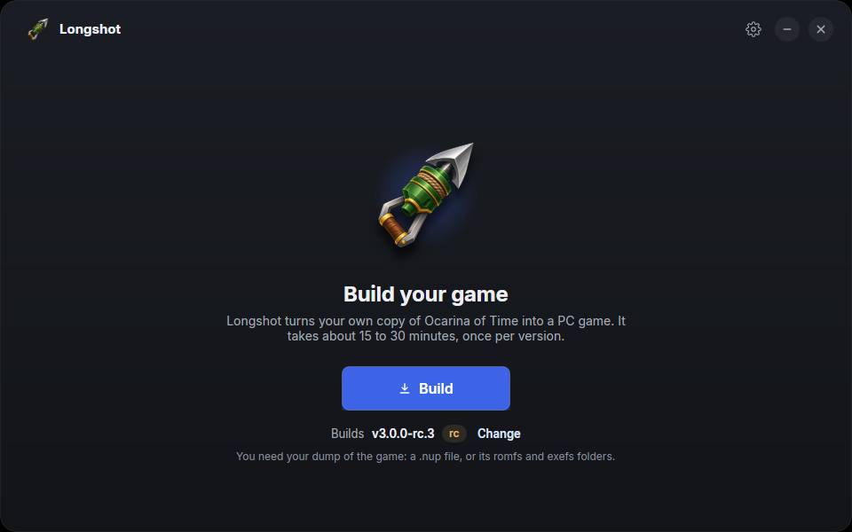
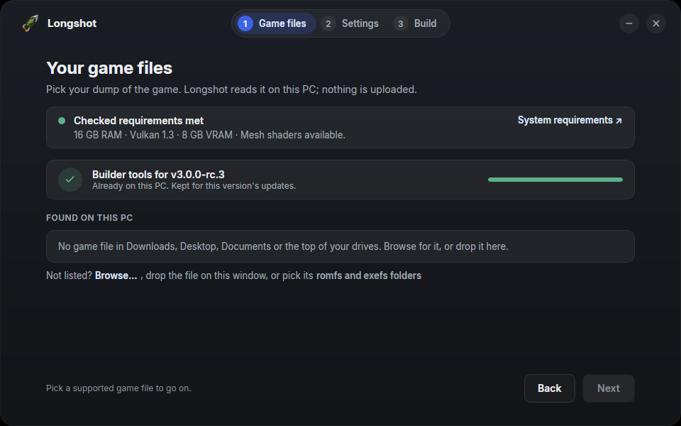

# Getting started

Longshot is built on your PC, from your own copy of the game, by the Longshot Launcher. It takes three steps.
**We do not host, store, or distribute game files, ROMs, game dumps, or decryption keys.**

## 1. Check your PC

Your copy of the game must be the supported version, and your PC needs a Vulkan 1.3 graphics card with 4 GB of video
memory (8 GB and mesh shaders recommended), 16 GB of memory and about 60 GB free while building. See [what you need](../README.md#what-you-need).

## 2. Download the launcher

- [Download for Windows](https://longshot.magicbean.dev/download/launcher/windows)
- [Download for Linux](https://longshot.magicbean.dev/download/launcher/linux)
- [Windows, portable zip](https://longshot.magicbean.dev/download/launcher/windows-portable)

Then follow [the Windows steps](../README.md#on-windows) or [the Linux steps](../README.md#on-linux) (on Linux and
SteamOS, the AppImage has to be made runnable first). Every channel, and the file for your system, is on the
[download page](https://longshot.magicbean.dev/download).

## 3. Build and play

Press **Build** on the launcher’s welcome screen.

*Longshot Launcher v1.0.0-rc.3 on Linux. The build version shown may change as new releases arrive.*

[Open full-size welcome screenshot](images/guide/launcher-home.png).

On **Game files**, choose your game from the list. If it is not listed, use **Browse…**, drop the file on the window,
or choose **romfs and exefs folders** for an extracted copy. Choose **Next** once the launcher has checked your selection.

*UI-only example from Launcher v1.0.0-rc.3 on Linux. The file list is deliberately empty; the hardware check and
tools-ready status are illustrative. No game files were searched or loaded for this image.*

[Open full-size game-file selection screenshot](images/guide/launcher-game-files.png).

Follow the remaining launcher steps to build. Building takes about 15 minutes on a 12-core desktop, and longer on
a slower PC. Then press **Play**. The first start prepares the game's shaders, so it's slower than the next ones.

See [the in-game menu](../README.md#in-game-menu) for settings and controls. If something goes wrong, start with
[Common problems](common-issues.md) and [the README's troubleshooting](../README.md#if-something-goes-wrong).
