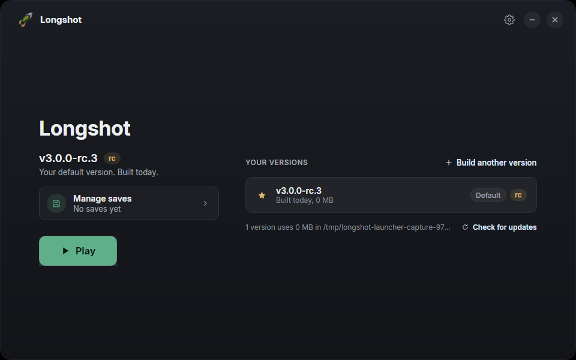
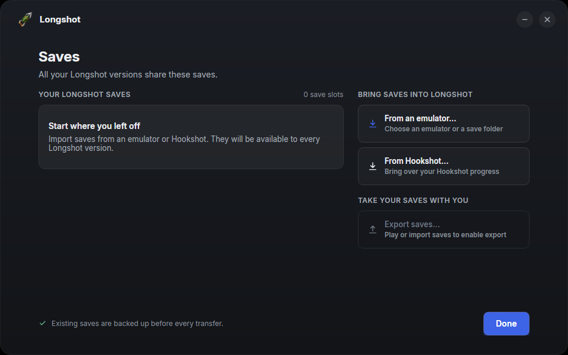
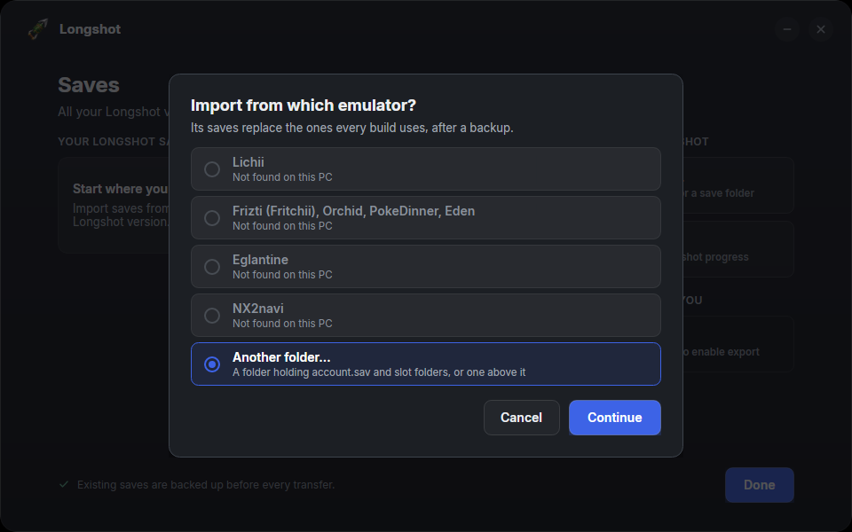
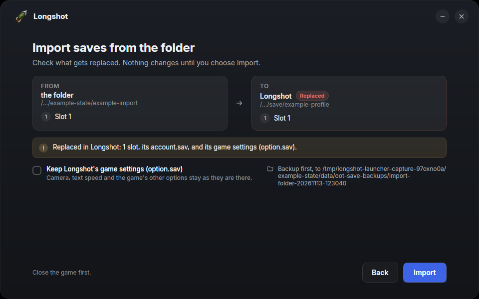

# Moving your saves

Your adventure is a handful of small files, the same in Longshot, Hookshot and the emulators that run the game, so it
moves between them as it is. The **Longshot Launcher** does it for you, from its **Saves** page: open **Manage saves**
on the launcher's home page, under the default version. On Windows, a version's **Saves** button opens that build's saves.



*UI-only example from Launcher v1.0.0-rc.3 on Linux, with a synthetic registered build. Choose Manage saves to reach
the page shown below; no game was built or launched for this image.*

[Open full-size Manage saves screenshot](images/guide/launcher-manage-saves.png).

Every copy **backs up the save it replaces first**, and the launcher won't copy while Longshot, Hookshot or an emulator is
running, since a running game can write its save again and undo the copy. A copy replaces the other side's slots: it
doesn't merge two adventures.

## Before you start

1. **Save and quit.** Save in the game, then quit it (and the emulator) from its own menu, so it finishes writing.
2. **Know which adventure you want.** Note the slot and roughly when you last played: the launcher lists every save it
   finds with its slots and when each was saved.



*Longshot Launcher v1.0.0-rc.3 on Linux, with no saves loaded. Export stays disabled until you play or import a save.
Linux builds share saves; Windows builds have separate saves in this launcher release.*

[Open full-size Saves page screenshot](images/guide/launcher-saves.png).

## Import a save into Longshot

### From an emulator

1. Start Longshot once and save, so its save folder exists, then quit it.
2. On the **Saves** page, choose **From an emulator…**. The launcher lists the emulators whose saves it found on this
   PC (Lichii, Eden, Eglantine, Orchid, PokeDinner, Fritzi and NX2navi), with their slots and save times.
3. Pick the emulator and, if asked, the profile you play on. If it isn't listed (a portable install, a copy on another
   drive), select **Another folder…**. Press **Continue**, then pick the save folder, or a folder that holds one.

   

   *Longshot Launcher v1.0.0-rc.3 on Linux. This empty example shows the manual-folder option; detected saves appear
   under their emulator names. Continue opens the folder picker; the later confirmation screen starts the import.*

   [Open full-size import chooser screenshot](images/guide/launcher-import.png).

4. Check **FROM**, **TO** and the replacement warning on the confirmation screen. Choose whether to keep the
   destination's game settings, and check the backup location.

   

   *UI-only example from Launcher v1.0.0-rc.3 on Linux. All paths and slots are synthetic examples made from text-only
   test files. Nothing was imported. Your source, slots and backup path will differ.*

   [Open full-size import confirmation screenshot](images/guide/launcher-import-confirm.png).

   When the source and destination are correct, press **Import**.
5. Start Longshot and load your slot.

### From Hookshot

Hookshot, the project Longshot continues, writes the same save files, so a Hookshot adventure carries on in Longshot.

1. On the **Saves** page, choose **From Hookshot…**. (When the launcher finds Hookshot saves, its home page also
   offers this once.)
2. Pick the save. The launcher looks where Hookshot keeps them; for anywhere else, use **Choose a folder…**.
3. If Longshot already has a save, the launcher asks before replacing it, backs it up whole, and tells you where.

Hookshot's own saves stay exactly as they were: nothing in its folders is moved or changed.

## Export a save from Longshot

1. Start the emulator you're going to, save once so its folders exist, then quit it. Close Longshot too.
2. On the **Saves** page, choose **Export saves…**, and pick the emulator, or **Another folder…** for anywhere else.
   Press **Continue** and choose a folder if asked.
3. Check the source and destination on the confirmation screen, then press **Export**.
4. Open the emulator and load your slot.

The emulator's save is backed up before it's replaced. The launcher doesn't export to Hookshot; the
[save script](#for-advanced-users-the-save-script) can.

## Between Longshot builds

- **Windows:** each build keeps its own saves. On the destination build's **Saves** page, choose **From another version…**.
  A new build or an update can also take your default build's saves itself: **Move my saves**, in the build wizard's
  second step.
- **Linux and Steam Deck:** every build already shares the same saves, so there's nothing to copy.

## Where Longshot keeps them

| | Your saves | The launcher's backups |
|---|---|---|
| Windows | `<game folder>\user\save\` (the game folder is `%USERPROFILE%\Games\Longshot` unless you chose another) | `%LOCALAPPDATA%\Longshot\oot-save-backups` |
| Linux and Steam Deck | `~/.local/share/longshot/save/` | `~/.local/share/oot-save-backups` |

To keep your own copy, copy the save folder while the game is closed. Keep save files private.

## Undo a copy

Each copy's backup is a folder in the backups folder above, named by when it was made. Close the game, then put that
folder's contents back into the save folder, the whole set of slots at once. If something looks wrong, stop before
copying again and [ask on Discord](https://discord.gg/magicbean), without posting your save files.

## For advanced users: the save script

Longshot has the same transfers on the command line: [`scripts/oot_saves.py`](../scripts/oot_saves.py), which needs only
Python 3. It also exports to Hookshot, handles custom folders, portable installs and several profiles, and previews a
copy with `--dry-run`:

```sh
python -I scripts/oot_saves.py list              # every save it finds, its slots and when each was saved
python -I scripts/oot_saves.py import lichii     # Lichii -> Longshot
python -I scripts/oot_saves.py export lichii     # Longshot -> Lichii
```

[Saves: the files, the script and the emulators](saves-script.md) has every command and option, where each emulator
keeps its saves, copying by hand and troubleshooting.
